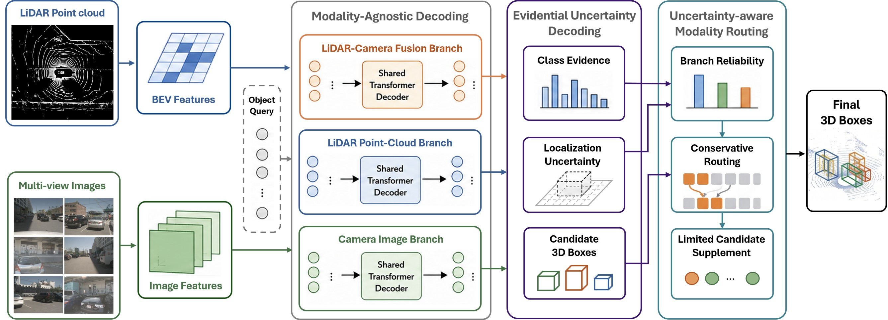

# Ev-MEFormer

Evidential, uncertainty-aware camera–LiDAR 3D object detection on nuScenes, built on top of
[MEFormer](https://github.com/MCG-NJU/MEFormer). One set of queries is decoded three times — over
the fused, LiDAR-only and camera-only representations — and two components sit on top of that:

- **EUD — Evidential Uncertainty Decoding.** The classification and 3D box heads emit evidential
  parameters instead of point estimates, so every query carries a calibrated reliability estimate
  alongside its prediction.
- **UMR — Uncertainty-aware Modality Routing.** Those uncertainty signals drive a router that
  decides, per head and per query, how much to trust the fused branch versus the LiDAR-only and
  camera-only branches when a sensor is degraded.

The design target is robustness under sensor corruption (evaluated on
[MultiCorrupt](https://github.com/ika-rwth-aachen/MultiCorrupt), 10 corruptions × 3 severities)
without sacrificing clean-nuScenes accuracy.



Further reading:

- [docs/model-architecture.md](docs/model-architecture.md) — the model in detail: encoders, the
  three-branch decoder, the evidential heads and losses, and the four UMR stages with their parameters.
- [docs/repository-layout.md](docs/repository-layout.md) — the directory tree, the config map
  (which configs you invoke and which exist only as `_base_` ancestors) and the module-name registry.

> **Always run commands from the repository root.** Configs declare
> `plugin_dir = 'projects/mmdet3d_plugin/'` and the tool scripts resolve `projects/configs/...`
> relative to the current working directory. Running from `projects/` — or bind-mounting
> `projects/` instead of the repository root — breaks plugin loading and every config path.

---

## Table of contents

1. [Environment setup](#1-environment-setup)
2. [Data and pretrained weights](#2-data-and-pretrained-weights)
3. [Training](#3-training)
4. [Inference and evaluation](#4-inference-and-evaluation)
5. [Tests](#5-tests)
6. [Troubleshooting](#6-troubleshooting)
7. [Citation](#citation)

---

## 1. Environment setup

Verified baseline: Python 3.8, PyTorch 1.13.1+cu117, MMCV-Full 1.6.0, MMDet 2.24.0,
MMDet3D 1.0.0rc5, MMSeg 0.29.1, spconv-cu117 2.3.6, flash-attn 1.0.5, NumPy 1.23.5.

> Never mix cu111 / cu117 / cu118 wheels of `torch`, `spconv` and `cumm`. The CUDA extension ABIs
> disagree, and the failure typically appears only after training has started.

> `flash-attn` is a **hard requirement**, not an optional accelerator.
> `projects/mmdet3d_plugin/models/utils/attention.py` imports it at module import time, so the
> plugin cannot be loaded at all without it. Version 1.0.5 is the last release compatible with
> torch 1.13.

### Docker (recommended)

```bash
bash scripts/build.sh     # builds the image; flash-attn compiles from source, so this is slow
bash scripts/start.sh     # starts a container with the repository root at /Ev-MEFormer
```

Edit `TORCH_CUDA_ARCH_LIST` in `dockerfile/Dockerfile` to match your GPUs (`8.0` A100,
`8.6` RTX 30xx/A6000, `8.9` RTX 40xx/6000 Ada) — trimming the list shortens the build a lot.
Adjust the `-v` mounts in `scripts/start.sh` to point at your own nuScenes and MultiCorrupt
copies.

Re-entering an existing container (note the trailing shell — `docker exec` needs it):

```bash
docker exec -it ev-meformer bash
cd /Ev-MEFormer
```

### Verifying the environment

```bash
python - <<'PY'
import torch, mmcv, mmdet, mmdet3d, flash_attn
print('torch:', torch.__version__, '| CUDA build:', torch.version.cuda)
print('CUDA available:', torch.cuda.is_available(), '| GPUs:', torch.cuda.device_count())
print('mmcv:', mmcv.__version__, '| mmdet:', mmdet.__version__, '| mmdet3d:', mmdet3d.__version__)
PY

python -c "import projects.mmdet3d_plugin; print('plugin OK')"   # from the repository root
```

---

## 2. Data and pretrained weights

### nuScenes

Register at [nuscenes.org](https://www.nuscenes.org/nuscenes), download v1.0-trainval with the
sensor blobs and maps under its licence, and extract to `data/nuscenes`:

```text
data/nuscenes/
├── maps/
├── samples/
├── sweeps/
├── v1.0-trainval/
├── nuscenes_infos_train.pkl
├── nuscenes_infos_val.pkl
└── nuscenes_dbinfos_train.pkl
```

Generate the info and GT-database files:

```bash
bash tools/create_data.sh
```

`data/`, `ckpts/`, `work_dirs/` and `*.pth` are gitignored — never commit datasets, metadata or
checkpoints.

#### Sharing an existing copy instead of extracting your own

nuScenes is ~400 GB of sensor data and `tools/create_data.sh` adds ~78 GB of metadata (the
GT database alone is 77 GB and takes hours to build), so on a shared machine it is usually better
to symlink an existing copy than to duplicate it. The configs address everything through
`data_root = 'data/nuscenes/'`, so only that directory's contents have to be right:

```bash
mkdir -p data/nuscenes
RAW=/path/to/nuscenes            # samples, sweeps, maps, v1.0-trainval
META=/path/to/nuscenes_metadata  # output of a previous tools/create_data.sh run

for d in samples sweeps maps v1.0-trainval; do
  ln -sfn "$RAW/$d" "data/nuscenes/$d"
done
for f in nuscenes_infos_train.pkl nuscenes_infos_val.pkl nuscenes_infos_test.pkl \
         nuscenes_dbinfos_train.pkl nuscenes_gt_database; do
  ln -sfn "$META/$f" "data/nuscenes/$f"
done
```

Symlinks created this way store **absolute host paths**, so every directory they point into must
be bind-mounted at the *same* path inside the container or the links dangle. `scripts/start.sh`
does that from `NUSCENES_RAW` and `NUSCENES_META`, mounting both read-only:

```bash
NUSCENES_RAW=/path/to/nuscenes NUSCENES_META=/path/to/nuscenes_metadata \
  bash scripts/start.sh
```

`scripts/start.sh` ships with no default paths, since the right ones differ per machine. To avoid
retyping them, keep a wrapper that exports your locations and execs it — anything matching
`scripts/*.local.sh` is gitignored:

```bash
#!/usr/bin/env bash
set -Eeuo pipefail
export NUSCENES_RAW=/path/to/nuscenes
export NUSCENES_META=/path/to/nuscenes_metadata
export MULTICORRUPT_ROOT=/path/to/MultiCorrupt
exec bash "$(dirname "${BASH_SOURCE[0]}")/start.sh" "$@"
```

Check the links from inside the container before training:

```bash
for l in data/nuscenes/*; do [ -e "$l" ] && echo "OK $l" || echo "BROKEN $l"; done
```

#### work_dirs

`work_dirs/` needs no mount of its own — it lives inside the repository, which is already
bind-mounted, so training output appears on the host by itself. Budget roughly 2.5 GB per EUD run
(six saved checkpoints at 471 MiB) and 1 GB per UMR chain, considerably more if you enable the
uncertainty sidecar. To put it on another disk, set `WORK_DIRS`; `scripts/start.sh` mounts it at
the same in-container path either way, so the paths recorded in `chain_manifest.json` and in
runtime packs stay valid:

```bash
WORK_DIRS=/big/disk/ev-meformer-work_dirs bash scripts/start.sh
```

### MultiCorrupt

Obtain or build the MultiCorrupt validation set following the
[MultiCorrupt project](https://github.com/ika-rwth-aachen/MultiCorrupt) and extract it to a disk
with enough space. All 10 corruptions × 3 severities must be present:

```text
<MULTICORRUPT_ROOT>/{beamsreducing,brightness,dark,fog,missingcamera,motionblur,
                     pointsreducing,snow,spatialmisalignment,temporalmisalignment}/{1,2,3}/
```

### Pretrained image backbones

Training from scratch starts from the MEFormer image-backbone weights. Get them from the
[MEFormer](https://github.com/MCG-NJU/MEFormer) release and place them exactly here — the EUD
configs reference these paths through `load_from`:

```text
ckpts/nuim_r50.pth                             # R50 route
ckpts/fcos3d_vovnet_imgbackbone-remapped.pth   # VoV route
```

### Released Ev-MEFormer checkpoints

If you only want to evaluate, skip training and take the trained R50 checkpoints from this
repository's [GitHub Releases](../../releases). They are the ones behind the numbers in
[4.4](#44-reference-results). Model weights are attached as release assets rather than committed —
both exceed GitHub's 100 MiB per-file limit for regular Git, and keeping them out of the history
means `git clone` stays small.

| Asset | Size | Pair it with | Reproduces |
|---|---:|---|---|
| `ev_meformer_r50_eud_epoch_20.pth` | 471 MiB | `projects/configs/edl_pme_bbox_r3c_cls_voxel0100_r50_800x320_cbgs.py` | line 1 |
| `ev_meformer_r50_umr_epoch_6.pth` | 162 MiB | `projects/configs/edl_pme_stage2_bbox_r3c_cls_voxel0100_r50_800x320_cbgs_v10_router_selector_frozen.py` | line 2 |

```bash
mkdir -p ckpts
# download both assets into ckpts/, then verify:
sha256sum -c - <<'SUMS'
4e35d25aa825b8df511c894eaa06ae3c440b50b06b2d9150c2559e47255acd95  ckpts/ev_meformer_r50_eud_epoch_20.pth
877539f655f9f7029ff9cd91c618c39a57a7288e3fcb79f1bd4feba4ba5a3f2c  ckpts/ev_meformer_r50_umr_epoch_6.pth
SUMS
```

The EUD checkpoint records `epoch: 20`, the UMR one `epoch: 6`; both are R50 and must never be
paired with a VoV config.

Line 3 is **not** reproducible from these two files alone. The bounded supplement is driven by a
runtime pack — a scene mapper, an action-utility mapper, clean reference statistics and the
candidate configs that reference them — and that pack is bound to both the checkpoint and the model
code that produced the statistics. A pack assembled during development is a diagnostic artifact
rather than a formal one: it predates the collector-code fingerprint, ships without the
`preflight.sh` and provenance manifest that `tools/prepare_r50_umr_sgsup_b.sh` now emits, and is
built against a base config that resolved its selector thresholds from an external calibration JSON
rather than inline. `run_r50_three_lines.sh` will only accept such a pack under an explicit
`ALLOW_NONFORMAL_RUNTIME=1`, and a run made that way must not be reported as a result.

To evaluate line 3 properly, rebuild the pack against this checkpoint with
`tools/prepare_r50_umr_sgsup_b.sh` (`RUN_COLLECT=1 RUN_CALIBRATE=1 SAMPLES_PER_GPU=1`, fresh output
root), then check admission with `tools/check_sgsup_admission_contract.py`. Expect the line-3 column
in [4.4](#44-reference-results) to shift if your rebuilt pack differs from the one those numbers
came from.

Identify a checkpoint by its recorded epoch and SHA256, never by filename — the UMR scripts check
`checkpoint['meta']['epoch']`, and the bounded-candidate supplement binds to the checkpoint SHA256:

```bash
sha256sum work_dirs/<run>/epoch_20.pth
python -c "import torch,sys; print(torch.load(sys.argv[1],map_location='cpu')['meta']['epoch'])" \
  work_dirs/<run>/epoch_20.pth
```

---

## 3. Training

Formal runs use **4 GPUs**. The EUD configs set `samples_per_gpu=2` and `cumulative_iters=2`,
giving an effective batch size of 16. Changing the GPU count changes the optimization semantics
and no longer reproduces the reported setting.

```bash
cd /Ev-MEFormer
export CUDA_VISIBLE_DEVICES=0,1,2,3
nvidia-smi
```

### 3.1 Stage 1 — EUD (20 epochs)

```bash
# R50
PORT=29500 bash tools/dist_train.sh \
  projects/configs/edl_pme_bbox_r3c_cls_voxel0100_r50_800x320_cbgs.py 4 \
  --work-dir work_dirs/r50_eud_final

# VoV
PORT=29510 bash tools/dist_train.sh \
  projects/configs/edl_pme_bbox_r3c_cls_voxel0075_vov_1600x640_cbgs.py 4 \
  --work-dir work_dirs/vov_eud_final
```

Confirm the result before continuing:

```bash
test -f work_dirs/r50_eud_final/epoch_20.pth && sha256sum work_dirs/r50_eud_final/epoch_20.pth
```

### 3.2 Stage 2 — the full UMR chain (one command)

```bash
# R50
CUDA_VISIBLE_DEVICES=0,1,2,3 CHAIN_ID=r50-run1 PORT=29600 \
  bash tools/train_r50_umr_complete.sh work_dirs/r50_eud_final/epoch_20.pth 4

# VoV
CUDA_VISIBLE_DEVICES=0,1,2,3 CHAIN_ID=vov-run1 PORT=29700 \
  bash tools/train_vov_umr_complete.sh work_dirs/vov_eud_final/epoch_20.pth 4
```

Output layout:

```text
work_dirs/r50_umr_complete/r50-run1/
├── branch_reliability_learning/.../epoch_6.pth
├── damage_aware_routing/.../epoch_4.pth
├── conservative_head_routing/.../epoch_6.pth
├── bounded_candidate_supplement/runtime_pack/
└── chain_manifest.json                          # the authoritative index of the run
```

`chain_manifest.json` records each stage's checkpoint, its SHA256, the runtime pack location and
the final config path. Prefer it over guessing paths.

The VoV conservative-routing config is *generated* from that run's damage-aware-routing
checkpoint after a calibration pass. Never copy a config or calibration JSON between runs.

Useful environment variables (`--help` lists them all):

| Variable | Meaning |
|---|---|
| `START_MODULE` | resume point: `branch_reliability_learning` (default), `damage_aware_routing`, `conservative_head_routing`, `bounded_candidate_supplement` |
| `CHAIN_ID` | run identifier; defaults to a UTC timestamp |
| `OUTPUT_ROOT` | default `work_dirs/{r50,vov}_umr_complete` |
| `PORT` | first module's port; later modules use `PORT+1`, `PORT+2`, `PORT+3` |
| `RUN_PREFLIGHT` | `1` (default) runs the per-stage contract checks |
| `RUN_BOUNDED_SUPPLEMENT` | `1` (default) builds the runtime pack at the end |
| `ALLOW_NONFORMAL_GPU_COUNT` | `1` permits a diagnostic run on ≠ 4 GPUs |

### 3.3 Resuming mid-chain

Read the run's `chain_manifest.json` or logs first to confirm which module and epoch a checkpoint
belongs to, then re-enter at that module with the **same** `CHAIN_ID`:

```bash
START_MODULE=damage_aware_routing CHAIN_ID=r50-run1 \
  bash tools/train_r50_umr_complete.sh /abs/path/to/branch_reliability_learning/epoch_6.pth 4

START_MODULE=conservative_head_routing CHAIN_ID=r50-run1 \
  bash tools/train_r50_umr_complete.sh /abs/path/to/damage_aware_routing/epoch_4.pth 4
```

Do not confuse `resume_from` with a cross-module `load_from`. Each module boundary starts a new
optimizer; crossing one must go through the chain script so the right checkpoint is loaded.

---

## 4. Inference and evaluation

### 4.0 Quick validation with an existing checkpoint

If you only want to reproduce a number on the clean nuScenes validation split, use the **EUD
checkpoint**. It is self-contained: one config, one checkpoint, no calibration JSON and no runtime
pack.

```bash
CUDA_VISIBLE_DEVICES=0 python tools/test.py \
  projects/configs/edl_pme_bbox_r3c_cls_voxel0100_r50_800x320_cbgs.py \
  ckpts/ev_meformer_r50_eud_epoch_20.pth \
  --eval bbox
```

or, multi-GPU:

```bash
PORT=29800 bash tools/dist_test.sh \
  projects/configs/edl_pme_bbox_r3c_cls_voxel0100_r50_800x320_cbgs.py \
  ckpts/ev_meformer_r50_eud_epoch_20.pth 4 --eval bbox
```

Expected clean-val reference: **NDS 0.6927 / mAP 0.6508** (R50).

The official nuScenes evaluator asserts that the predicted sample tokens cover the whole val split,
so `--eval bbox` always needs all 6019 frames — there is no supported way to score a subset. To
smoke-test a fresh setup quickly, subset the data and skip scoring instead: `--format-only` writes
the detections without evaluating them, which still exercises checkpoint loading, the data
pipeline, the forward pass and bbox decoding.

```bash
python tools/test.py \
  projects/configs/edl_pme_bbox_r3c_cls_voxel0100_r50_800x320_cbgs.py \
  ckpts/ev_meformer_r50_eud_epoch_20.pth \
  --format-only --eval-options jsonfile_prefix=work_dirs/smoke \
  --cfg-options data.test.load_interval=100
```

Then check the output is real rather than empty — 61 frames, up to `max_num=300` boxes each, with a
sensible score distribution:

```bash
python -c "
import json; r = json.load(open('work_dirs/smoke/pts_bbox/results_nusc.json'))['results']
print('frames:', len(r), '| boxes:', sum(len(v) for v in r.values()))"
```

`--eval` and `--format-only` are mutually exclusive; combining `--eval bbox` with `load_interval`
fails in the evaluator with `Samples in split doesn't match samples in predictions`.

The next step up is the **matched UMR baseline** — the conservative-head-routing checkpoint with
the bounded supplement disabled. It reaches NDS 0.6888 / mAP 0.6437 on clean val:

```bash
CUDA_VISIBLE_DEVICES=0 python tools/test.py \
  projects/configs/edl_pme_stage2_bbox_r3c_cls_voxel0100_r50_800x320_cbgs_v10_router_selector_frozen.py \
  ckpts/ev_meformer_r50_umr_epoch_6.pth \
  --eval bbox
```

The selector's oracle thresholds and matching mode have to match the checkpoint. `_frozen` carries
them inline, so it is safe to use straight from a checkout. If you are evaluating a checkpoint from
a *different* run, use the dumped config saved next to that checkpoint instead — it has that run's
own calibrated values baked in. Never pair a checkpoint with thresholds calibrated for another one.

The bounded-candidate supplement (line 3) additionally needs a runtime pack built for that exact
checkpoint *and* for the current code — see [4.3](#43-r50-three-line-validation-driver).

### 4.1 Clean nuScenes

Take `conservative_head_routing_checkpoint` and `formal_final_config` from `chain_manifest.json`.
The final config is *not* self-contained — it references the mappers, reference statistics and
provenance manifest inside the same runtime pack, so keep the whole
`bounded_candidate_supplement/runtime_pack/` directory together and run its preflight first.

```bash
FINAL_CONFIG=/abs/path/to/runtime_pack/configs/<final_config>.py
FINAL_CKPT=/abs/path/to/conservative_head_routing/epoch_6.pth
RUNTIME_PACK=/abs/path/to/runtime_pack

bash "$RUNTIME_PACK/preflight.sh" "$FINAL_CONFIG"
PORT=29800 bash tools/dist_test.sh "$FINAL_CONFIG" "$FINAL_CKPT" 4 --eval bbox
```

If preflight reports a checkpoint-SHA, config, artifact or code-fingerprint mismatch, stop. Do
not disable the check and run anyway — the mismatch means the runtime pack does not belong to
that checkpoint.

Single-GPU inference (diagnostics only):

```bash
python tools/test.py "$FINAL_CONFIG" "$FINAL_CKPT" --eval bbox
```

### 4.2 MultiCorrupt (10 × 3)

`multicorrupt_evaluation.sh` temporarily moves the clean `data/nuscenes` aside, builds a symlink
assembly per corruption, and restores everything through a trap. **Do not run anything else that
reads or writes `data/nuscenes` at the same time.**

Preferred path — the helper generated inside the runtime pack, which forces preflight:

```bash
export MULTICORRUPT_ROOT=/path/to/MultiCorrupt
export NUSCENES_DATA_DIR=/Ev-MEFormer/data/nuscenes
export NUSCENES_BACKUP_DIR=/Ev-MEFormer/data/nuscenes.multicorrupt-backup
export BASE_CKPT=/abs/path/to/conservative_head_routing/epoch_6.pth
export OUT_DIR=/Ev-MEFormer/MultiCorrupt_results/<run-id>
export RUN_VIZ=0
export EV_LOG_MODE=off

bash /abs/path/to/runtime_pack/validate_full_candidate.sh <candidate_name>
```

Or call the sweep directly, supplying config and checkpoint explicitly:

```bash
MULTICORRUPT_ROOT=/path/to/MultiCorrupt \
NUSCENES_DATA_DIR=/Ev-MEFormer/data/nuscenes \
NUSCENES_BACKUP_DIR=/Ev-MEFormer/data/nuscenes.multicorrupt-backup \
CONFIG=/abs/path/to/runtime_pack/configs/<final_config>.py \
CKPT=/abs/path/to/conservative_head_routing/epoch_6.pth \
OUT_DIR=/Ev-MEFormer/MultiCorrupt_results/<run-id> \
MODEL_LABEL=<unique-label> \
RUN_VIZ=0 EV_LOG_MODE=off \
bash multicorrupt_evaluation.sh
```

Notes:

- The script validates all 30 corruption/severity directories, the clean info files, the config,
  the checkpoint and the Python environment *before* it moves the dataset.
- `NUSCENES_DATA_DIR` must resolve to this repository's `data/nuscenes`, because the formal
  configs use that relative data root.
- `NUSCENES_BACKUP_DIR` must be on the same filesystem as `data/nuscenes`, so the `mv` is fast
  and reversible.
- If a previous run was killed and the backup still exists, inspect both directories and restore
  manually. Never just delete the backup.
- For metrics-only runs use `EV_LOG_MODE=off RUN_VIZ=0` — it saves a lot of disk. Enable logging
  only when you need the uncertainty sidecar or plots.
- Results land in `$OUT_DIR/evaluation_log.txt` and `$OUT_DIR/metrics_summary.txt`, covering NDS,
  mAP, RA, mRA, RRA and mRRA.

Single-corruption probe:

```bash
CONFIG=... CKPT=... MODEL_LABEL=... CORRUPTIONS=fog SEVERITY_LEVELS=3 \
  bash run_targeted_corruption_probe.sh
```

### 4.3 R50 three-line validation driver

`run_r50_three_lines.sh` runs the three comparison lines end to end and writes one result tree:

| Line | What it evaluates |
|---|---|
| `line1_eud` | the EUD checkpoint on its own |
| `line2_umr_base` | the matched UMR checkpoint, bounded supplement **disabled** |
| `line3_umr_supplement` | the same UMR checkpoint, guarded bounded supplement **enabled** |

It always drives MultiCorrupt, so `MULTICORRUPT_ROOT` is mandatory — for a plain clean-val number
use [4.0](#40-quick-validation-with-an-existing-checkpoint) instead.

```bash
# Full-10, all three lines, resolved from a chain manifest
CUDA_VISIBLE_DEVICES=0 \
MULTICORRUPT_ROOT=/path/to/MultiCorrupt \
CHAIN_MANIFEST=/path/to/r50/chain_manifest.json \
EVAL_MODE=full RUN_VIZ=0 EV_LOG_MODE=off \
  bash run_r50_three_lines.sh

# Targeted canary: matched vs guarded on clean + beamsreducing severity 3
EVAL_MODE=targeted LINES="line2_umr_base line3_umr_supplement" \
CORRUPTIONS=beamsreducing SEVERITY_LEVELS=3 \
MULTICORRUPT_ROOT=/path/to/MultiCorrupt \
CHAIN_MANIFEST=/path/to/chain_manifest.json \
  bash run_r50_three_lines.sh
```

`bash run_r50_three_lines.sh --help` lists every variable. `CHAIN_MANIFEST` is preferred: it
resolves `UMR_CKPT` and `RUNTIME_PACK` for you. A formal line2/line3 run must use the
checkpoint-specific runtime pack built by `tools/prepare_r50_umr_sgsup_b.sh`; historical configs
are accepted only under an explicit `ALLOW_NONFORMAL_RUNTIME=1`, and such a run is a diagnostic,
never a reportable result.

After a guarded run, audit the scene-summary sidecars. A correct line3 reports 18 expected,
18 available, 18 finite, zero missing, `contract_ready=1` and `q95_available=1` at admission, and
prints no `missing_or_invalid` warning:

```bash
python tools/check_sgsup_admission_contract.py \
  <result_root>/**/scene_summary*.jsonl[.gz]

# The matched baseline must carry no supplement telemetry at all
python tools/check_sgsup_admission_contract.py --expect-supplement-off \
  <matched_result_root>/**/scene_summary*.jsonl[.gz]
```

The audit is fail-closed on the feature contract only. Gate rates and added-candidate ratios are
reported as diagnostics: they are distribution-specific and must never be tuned against
MultiCorrupt. This distinction matters when reading a line3 result — a near-identity with the
matched baseline is only meaningful as a null effect if the contract passed. If it did not, the
gate was closed and the run says nothing about supplement efficacy.

### 4.4 Reference results

R50, Full-10 MultiCorrupt plus clean nuScenes validation. Use these to check that a rebuilt chain
or a reused checkpoint lands where it should.

| Line | Clean NDS | Clean mAP | mRA NDS | mRA mAP |
|---|---:|---:|---:|---:|
| Line 1 — EUD | 0.6927 | 0.6508 | 0.8501 | 0.7443 |
| Line 2 — UMR matched baseline | 0.6888 | 0.6437 | 0.8514 | 0.7443 |
| Line 3 — UMR + bounded supplement | 0.6885 | 0.6432 | 0.8530 | 0.7502 |

Per-corruption relative accuracy (RA), averaged over the three severities:

| Corruption | L1 RA NDS | L1 RA mAP | L2 RA NDS | L2 RA mAP | L3 RA NDS | L3 RA mAP |
|---|---:|---:|---:|---:|---:|---:|
| beamsreducing | 0.7050 | 0.5106 | 0.7011 | 0.5080 | 0.7247 | 0.5730 |
| brightness | 0.9665 | 0.9214 | 0.9651 | 0.9164 | 0.9654 | 0.9170 |
| dark | 0.9756 | 0.9407 | 0.9744 | 0.9370 | 0.9748 | 0.9378 |
| fog | 0.7987 | 0.6196 | 0.8102 | 0.6335 | 0.8078 | 0.6309 |
| missingcamera | 0.9660 | 0.9280 | 0.9651 | 0.9269 | 0.9654 | 0.9273 |
| motionblur | 0.8505 | 0.7760 | 0.8532 | 0.7685 | 0.8535 | 0.7689 |
| pointsreducing | 0.8940 | 0.8410 | 0.8959 | 0.8429 | 0.8953 | 0.8419 |
| snow | 0.8262 | 0.7056 | 0.8254 | 0.7005 | 0.8247 | 0.6993 |
| spatialmisalignment | 0.7362 | 0.5776 | 0.7415 | 0.5873 | 0.7355 | 0.5832 |
| temporalmisalignment | 0.7819 | 0.6226 | 0.7826 | 0.6225 | 0.7826 | 0.6225 |

Absolute NDS / mAP per corruption and severity:

| Corruption | Sev. | L1 NDS | L1 mAP | L2 NDS | L2 mAP | L3 NDS | L3 mAP |
|---|---:|---:|---:|---:|---:|---:|---:|
| beamsreducing | 1 | 0.6279 | 0.5425 | 0.6244 | 0.5357 | 0.6239 | 0.5349 |
| beamsreducing | 2 | 0.4990 | 0.3408 | 0.4941 | 0.3349 | 0.4917 | 0.3325 |
| beamsreducing | 3 | 0.3381 | 0.1136 | 0.3302 | 0.1104 | 0.3812 | 0.2382 |
| brightness | 1 | 0.6771 | 0.6166 | 0.6723 | 0.6068 | 0.6722 | 0.6067 |
| brightness | 2 | 0.6712 | 0.6020 | 0.6666 | 0.5925 | 0.6665 | 0.5924 |
| brightness | 3 | 0.6602 | 0.5804 | 0.6553 | 0.5703 | 0.6553 | 0.5704 |
| dark | 1 | 0.6816 | 0.6257 | 0.6780 | 0.6181 | 0.6780 | 0.6181 |
| dark | 2 | 0.6759 | 0.6118 | 0.6707 | 0.6023 | 0.6708 | 0.6024 |
| dark | 3 | 0.6699 | 0.5992 | 0.6647 | 0.5890 | 0.6646 | 0.5890 |
| fog | 1 | 0.6557 | 0.5740 | 0.6577 | 0.5769 | 0.6572 | 0.5763 |
| fog | 2 | 0.6135 | 0.4903 | 0.6169 | 0.4958 | 0.6163 | 0.4947 |
| fog | 3 | 0.3905 | 0.1455 | 0.3995 | 0.1506 | 0.3950 | 0.1464 |
| missingcamera | 1 | 0.6797 | 0.6260 | 0.6754 | 0.6187 | 0.6753 | 0.6185 |
| missingcamera | 2 | 0.6695 | 0.6037 | 0.6654 | 0.5973 | 0.6653 | 0.5971 |
| missingcamera | 3 | 0.6582 | 0.5821 | 0.6535 | 0.5739 | 0.6534 | 0.5738 |
| motionblur | 1 | 0.6632 | 0.6006 | 0.6593 | 0.5929 | 0.6593 | 0.5927 |
| motionblur | 2 | 0.5916 | 0.5034 | 0.5896 | 0.4919 | 0.5897 | 0.4919 |
| motionblur | 3 | 0.5126 | 0.4111 | 0.5142 | 0.3993 | 0.5140 | 0.3991 |
| pointsreducing | 1 | 0.6538 | 0.5955 | 0.6513 | 0.5904 | 0.6509 | 0.5897 |
| pointsreducing | 2 | 0.6299 | 0.5610 | 0.6272 | 0.5560 | 0.6267 | 0.5552 |
| pointsreducing | 3 | 0.5742 | 0.4854 | 0.5728 | 0.4814 | 0.5716 | 0.4797 |
| snow | 1 | 0.6048 | 0.5192 | 0.6014 | 0.5114 | 0.6000 | 0.5093 |
| snow | 2 | 0.5742 | 0.4627 | 0.5702 | 0.4537 | 0.5696 | 0.4529 |
| snow | 3 | 0.5380 | 0.3958 | 0.5341 | 0.3876 | 0.5338 | 0.3872 |
| spatialmisalignment | 1 | 0.5733 | 0.4704 | 0.5714 | 0.4657 | 0.5710 | 0.4653 |
| spatialmisalignment | 2 | 0.5076 | 0.3693 | 0.5073 | 0.3702 | 0.5048 | 0.3674 |
| spatialmisalignment | 3 | 0.4489 | 0.2881 | 0.4536 | 0.2982 | 0.4434 | 0.2927 |
| temporalmisalignment | 1 | 0.6176 | 0.5257 | 0.6139 | 0.5196 | 0.6136 | 0.5192 |
| temporalmisalignment | 2 | 0.5354 | 0.3930 | 0.5332 | 0.3888 | 0.5330 | 0.3886 |
| temporalmisalignment | 3 | 0.4719 | 0.2969 | 0.4700 | 0.2937 | 0.4698 | 0.2934 |

Line 3 gains most where LiDAR geometry degrades hardest — `beamsreducing` severity 3 is the clearest
case (NDS 0.3302 to 0.3812, mAP 0.1104 to 0.2382). Elsewhere it tracks line 2 closely, which is the
intended conservative behaviour, not a null result; confirm the feature contract passed before
reading any near-identity that way.

### 4.5 Visualization

```bash
bash tools/runtime_visualize.sh              # detections with routing/uncertainty overlays
bash tools/runtime_supplement_visualize.sh   # the same, annotated with supplement decisions
python tools/ev_meformer_corruption_viz.py   # corruption comparison figures
python tools/render_multicorrupt_examples.py # MultiCorrupt example panels
python tools/visualize_edl_logs.py           # uncertainty sidecar plots
```

---

## 5. Tests

The unit tests are CPU-only and need no dataset or checkpoint. Run them from the repository root:

```bash
python -m pytest tests tools/test_*.py -q
bash tools/test_umr_functional_naming.sh
```

85 tests cover the routing feature contracts, the scene-mapper admission contract, the pure-BEV
abstain guard, the collector-code fingerprint, runtime-pack provenance, R50/VoV config parity,
preflight coverage and the module-name registry.

---

## 6. Troubleshooting

| Symptom | Cause and fix |
|---|---|
| `ModuleNotFoundError: No module named 'flash_attn'` | flash-attn is missing. Install `flash-attn==1.0.5` with `--no-build-isolation`; the plugin cannot import without it. |
| `No module named 'projects'`, or configs resolving to `projects/projects/configs/...` | You are not in the repository root, or you mounted `projects/` instead of the root. Run from the root and mount the root. |
| Plugin registry errors (`KeyError: 'EDLHead is not in the models registry'`) | `plugin_dir` could not be resolved — same cause as above. |
| CUDA extension errors that only appear after training starts | Mixed CUDA wheel versions. Keep torch, spconv and cumm all on cu117. |
| Preflight reports a checkpoint-SHA or fingerprint mismatch | The runtime pack does not match this checkpoint, or was collected with different model code. Rebuild it under a new output root with `RUN_COLLECT=1 RUN_CALIBRATE=1 SAMPLES_PER_GPU=1`; do not bypass the check. No checkpoint needs retraining — only the train-only calibration and the downstream validation. |
| `[UMR-SUP][WARN] ... missing_or_invalid=[...]` during a line3 run | The scene mapper could not resolve every feature, so the gate failed closed and the supplement never ran. Audit with `tools/check_sgsup_admission_contract.py`; the result cannot be used to judge supplement efficacy. |
| `data/nuscenes` looks wrong after an interrupted MultiCorrupt run | The trap did not fire. Inspect `data/nuscenes` and `data/nuscenes.multicorrupt-backup` and restore manually. |
| R50 artifacts appear to "work" on VoV | They do not. Checkpoints, calibration JSONs and runtime packs are bound to a backbone, config, checkpoint and data distribution. Never cross them. |

---

## Citation

Our paper has been accepted for oral presentation at the 23rd International Conference on
Automation Technology (Automation 2026).

If you find our work useful in your research, please consider citing:

```bibtex
@inproceedings{hsieh2026evmeformer,
  title     = {Ev-MEFormer: Evidential Uncertainty-Aware Multimodal 3D Object Detection for Robust Mobile Robot Perception},
  author    = {Hsieh, Yen-Yu and Hsu, Hui-Che and Chen, Ting-Yu and Sun, Yi-Heng and Jhong, Sin-Ye and Tsai, Jung-Ting and Chen, Yung-Yao},
  booktitle = {Proceedings of the 23rd International Conference on Automation Technology (Automation 2026)},
  year      = {2026},
  note      = {To appear. Oral presentation}
}
```

---

## Acknowledgements

Built on [MEFormer](https://github.com/hanchaa/MEFormer), which in turn builds on
[MMDetection3D](https://github.com/open-mmlab/mmdetection3d), PETR/DETR3D and CMT. Robustness
evaluation follows [MultiCorrupt](https://github.com/ika-rwth-aachen/MultiCorrupt). The evidential
formulation draws on Deep Evidential Regression, E-DETR and MT-ENet.

Licensed under the MIT License — see [LICENSE](LICENSE).
