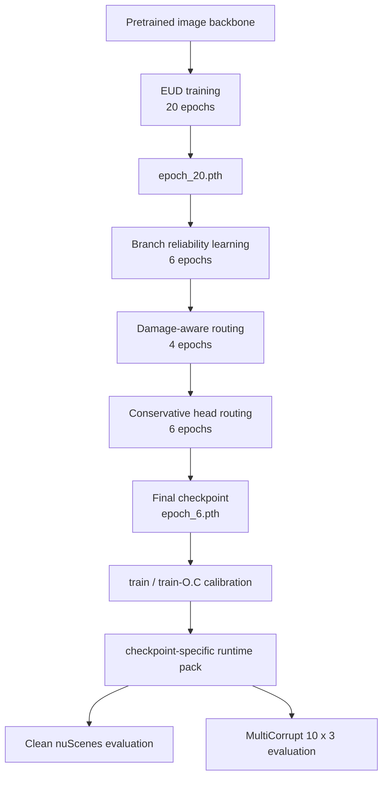

# Model architecture

The full description of Ev-MEFormer: backbones and encoders, the three-branch decoder, the
evidential heads (EUD) and the uncertainty-aware routing stages (UMR), with the parameters each
one is configured with. See [repository-layout.md](repository-layout.md) for where these pieces
live in the tree, and the [README](../README.md) for setup, training and evaluation.


---

## 1. Backbone and encoders

```
6× camera images ──► ResNet-50 or VoVNet V-99-eSE ──► CPFPN ──► RV features
                                                                      │
LiDAR point cloud ──► SPConvVoxelization ──► HardSimpleVFE            │
                      ──► SparseEncoder (spconv) ──► SECOND ──► SECONDFPN ──► BEV features
```

| | R50 route | VoV route |
|---|---|---|
| Image backbone | ResNet-50 (`out_indices=(2, 3)`) | VoVNet V-99-eSE |
| Image resolution | 800 × 320 | 1600 × 640 |
| Voxel size | `[0.1, 0.1, 0.2]` | `[0.075, 0.075, 0.2]` |
| Sparse shape | `[41, 1024, 1024]` | `[41, 1440, 1440]` |
| Point cloud range | `[-54, -54, -5, 54, 54, 3]` | same |
| Classes | 10 nuScenes classes | same |
| Pretrained image weights | `ckpts/nuim_r50.pth` | `ckpts/fcos3d_vovnet_imgbackbone-remapped.pth` |

## 2. Multi-modal decoding (MOADTransformer)

`MOADTransformer` runs the **same** 6-layer PETR-style decoder over three different
memory/query combinations, producing three parallel branches from one set of queries:

| Branch | Memory | Query embedding |
|---|---|---|
| `fused` | `concat(BEV, RV)` | `bev_query_embed + rv_query_embed` |
| `bev` | BEV only | `bev_query_embed` |
| `img` (RV) | RV only, optionally scaled by the camera-extrinsics embedding | `rv_query_embed` |

Training uses all three (`modalities.train = ["fused", "bev", "img"]`); the plain EUD stage
tests on `fused` only. UMR is what makes the non-fused branches useful at test time.

## 3. EUD — evidential heads

`EDLNIGHead` widens the regression heads by 4× for the evidential tasks and emits
`[gamma, v, alpha, beta]` interleaved per dimension:

| Task | Dims | Parameterisation |
|---|---|---|
| `center` | 2 | NIG (8 channels) |
| `height` | 1 | NIG (4 channels) |
| `dim` | 3 | plain regression — object size does not change under sensor degradation |
| `rot` | 2 | plain regression — sin/cos are geometrically constrained |
| `vel` | 2 | plain regression |
| `cls` | 10 | Beta evidence, `num_cls × 2` channels (`alpha`, `beta`); the exported logit is `log(alpha/beta)` |

`EDLHead` computes the losses:

- **L1** on gamma, with separate weights for the evidential tasks (`l1_weight`) and the plain
  ones (`l1_weight_standard`).
- **NIG NLL + regularizer** (`nig_nll_weight`, `nig_reg_weight ≈ 1e-4`) on center/height.
- **Optional Lipschitz L1** (MT-ENet, Proposition 2): where `chi² > U_l` the gradient is scaled
  by `1 / L` with `L = sqrt(2β(1+v)/(αv))`, compensating for the vanishing NLL gradient. Unlike
  the original, `v/α/β` are *not* detached, which prevents evidence contraction in 3D.
- **Evidential classification** with dynamic KL and iteration-based warmup.
- Denoising (DN) queries use the same layout and loss path.

Epistemic uncertainty per query is `eps = beta / ((alpha - 1) * v)`; `EDLBBoxCoder` decodes the
NIG parameters back to boxes and attaches that uncertainty to the detections.

## 4. UMR — uncertainty-aware routing

`EDLPMETransformer` consumes the three branches plus their uncertainties and produces the final
prediction. Its behaviour is selected by `ensemble.ensemble_mode`; the reproduction path uses
`damage_gated_soft_router`. The learned pieces are trained in three stages:

1. **Branch candidate and reliability signal learning** (6 epochs). Learns per-branch reliability
   and damage representations. Trained with `OnlineSyntheticMultiCorrupt` at `corrupt_prob=0.5`
   so the model sees degraded LiDAR and camera during training. Losses include gate, modality and
   domain-reliability supervision plus a clean-anchor term that keeps clean-scene behaviour fixed.
2. **Routing training with damage-state supervision** (4 epochs). *Backbones, necks and the
   detection head are frozen* (`lr_mult=0.0`); only `v9_bev_anomaly_head`, `v9_img_anomaly_head`
   and `v9_fused_gate_head` train. Adds tail-statistics anomaly features, an online `tau`
   threshold, and route weights over other-modality damage, self damage, context, distance and
   branch disagreement.
3. **Per-head conservative routing** (6 epochs). A quality/selector model
   (`projects/mmdet3d_plugin/models/utils/v10_quality.py`) makes the switch decision separately per
   detection head, against oracle thresholds obtained from a calibration pass. Those thresholds
   belong to the checkpoint they were calibrated on: the R50 reproduction config carries them
   inline (`v10_oracle_thresholds`, `v10_matching_mode`) so a fresh checkout resolves the same
   contract, and the VoV chain generates a per-run child config instead. Conservatism here is what
   keeps clean-scene accuracy from regressing when routing fires spuriously.

4. **Bounded candidate supplement** (no weight updates). A calibration pass over train / train-O.C
   fits mappers and reference statistics, then emits a **checkpoint-specific runtime pack**
   (configs, mappers, provenance manifest, `preflight.sh`, validation helpers) that recovers
   candidates within a bounded budget at inference time.

   The scene mapper that gates this supplement reads 18 features, several of them per-scene
   quantiles of query-level tensors (for example `scene_v9_fused_keep_unit_q95`, the p95 of
   `v9_fused_keep_unit`). A quantile is only accepted from a finite, batch-first, query-level
   tensor with at least two dimensions — scalars, `[B]` tensors, wrong-batch, empty and non-finite
   values are refused rather than broadcast, because the same names also appear as post-admission
   batch-global telemetry and substituting those would silently skew training against serving. If
   any feature is unresolved the gate **fails closed** and the supplement is simply not applied.
   Admission publishes the expected / available / finite / missing counts, contract readiness and
   q95 availability, so a closed gate can be told apart from a genuine no-op.

   Because the mapper is fitted on statistics that the model code itself produces, a runtime pack
   is bound to the *code* as well as to the checkpoint. Every EV meta shard carries a
   collector-code fingerprint over the transformer, logger, head merge, synthetic-corruption
   pipeline, test runner, log-config builder and collection wrapper; the provenance stamper and the
   portable preflight reject a pack whose fingerprint differs from the checked-out tree. Formal
   collection also requires `SAMPLES_PER_GPU=1`, so the logged per-scene statistics are per scene
   rather than batch-global.



Each stage establishes a new optimizer lifecycle and checkpoint boundary, so this is **not** a
single config run for 36 epochs. The chain scripts handle the boundaries, run a preflight check
before each stage, and verify the source checkpoint's recorded epoch.

The four stages have canonical functional names (`branch_reliability_learning`,
`damage_aware_routing`, `conservative_head_routing`, `bounded_candidate_supplement`); the `v8` /
`v9` / `v10` fragments that appear in config filenames are historical aliases for them, mapped in
[repository-layout.md](repository-layout.md#module-naming).
